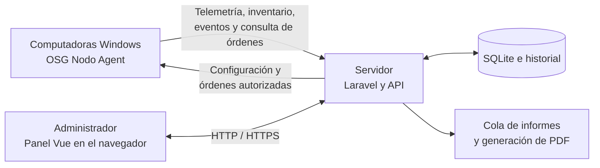

# OSG Nodo Control

**Monitoreo y administración centralizada de computadoras Windows desde un panel web.**

OSG Nodo Control permite consultar el estado de los equipos de una red, reunir
inventario y diagnósticos, revisar consumo de recursos y ejecutar acciones
administrativas autorizadas. Se compone de un **servidor Laravel con panel Vue**
y un **agente Python que se instala en cada computadora Windows administrada**.

El servidor recibe lo que envían los agentes, guarda el historial y permite
consultarlo desde un navegador. El agente obtiene información del equipo,
la envía al servidor y consulta si hay órdenes pendientes para ejecutarlas y
comunicar su resultado.

[Instalar el servidor](#instalar-el-servidor) ·
[Instalar y vincular agentes](#instalar-y-vincular-los-agentes-windows) ·
[Guía Docker completa](DOCKER-LINUX-WINDOWS.md) ·
[Descargas del agente](https://github.com/denuczi/osg-control/releases)

## Cómo funciona

| Componente | Dónde se instala | Responsabilidad |
| --- | --- | --- |
| **Servidor OSG Nodo Control** | Un equipo servidor Linux, o Debian dentro de WSL2 en Windows | Alojar Laravel, el panel web, la API, la base de datos, las tareas de mantenimiento y la generación de informes. Debe ser accesible por los agentes. |
| **OSG Nodo Agent** | Cada computadora Windows 10/11 x64 que se quiere administrar | Recoger métricas, inventario y eventos; enviarlos al servidor; recibir configuración y ejecutar las acciones autorizadas. |
| **Navegador del administrador** | El servidor u otro equipo con acceso al panel | Consultar la información, aprobar vinculaciones, administrar equipos y solicitar informes u órdenes. |



**Se instala un servidor para recibir a los agentes y un agente por computadora
Windows.** Laravel se ejecuta en el servidor y distribuye el panel Vue, cuya
interfaz se ejecuta en el navegador del administrador. La comunicación del
equipo monitoreado la inicia el agente hacia el servidor,
por lo que no necesita un puerto entrante en cada computadora Windows.

## Funciones del sistema

### Monitoreo, inventario y diagnóstico

- **Panel general y listado de equipos:** estado conectado/desconectado,
  búsqueda, identificación del equipo y resumen de las últimas métricas.
- **Telemetría e historial:** CPU, memoria, almacenamiento y tráfico de red,
  con gráficos y períodos de consulta. La actualización depende de los
  intervalos configurados.
- **Inventario:** procesador, memoria, volúmenes, adaptadores de red y datos
  de hardware informados por Windows.
- **Diagnóstico:** hardware y batería, indicadores de discos, estado de
  Microsoft Defender y firewall, actualizaciones pendientes y eventos
  seleccionados de Windows. La disponibilidad de cada dato depende del
  hardware, los permisos y las API del sistema operativo.
- **Consumo de red:** consultas por equipo y del conjunto de equipos,
  con acumulados de recepción y envío y selección de períodos.
- **Procesos:** listado y agrupación de procesos, consumo de recursos y
  descripciones técnicas desde un catálogo, con consulta opcional a IA.
- **Medios extraíbles:** historial de eventos de conexión y extracción de
  volúmenes USB y medios ópticos detectados por el agente.

### Administración de equipos

- **Vinculación aprobada por el administrador:** solicitud desde Windows y
  verificación mediante un código de seis dígitos en el panel.
- **Ciclo de vida del equipo:** cambiar el nombre visible, revocar acceso,
  archivar, restaurar al inventario o eliminar el registro y sus datos asociados.
  Restaurar al inventario conserva la revocación hasta una nueva vinculación.
- **Órdenes remotas individuales:** enviar mensajes, solicitar apagado o
  reinicio y finalizar procesos compatibles con las comprobaciones de seguridad.
- **Operaciones masivas:** mensajes, apagado y reinicio para varios equipos
  conectados, con confirmación y registro de las órdenes.
- **Historial de actividad:** acciones administrativas, vinculaciones,
  solicitudes de informes y resultados de órdenes.
- **Configuración centralizada:** intervalos de métricas, heartbeat y consulta
  de órdenes, actualización del panel, retención de telemetría y zona horaria.
- **Trabajo ante desconexiones:** almacenamiento local de telemetría en SQLite
  y reintentos de envío cuando el servidor vuelve a estar disponible.

Las órdenes se limitan a las acciones implementadas. La finalización de procesos
comprueba su identidad y protege procesos críticos; Windows determina si la
operación puede ejecutarse. Los mensajes se muestran en sesiones interactivas
disponibles y su confirmación no demuestra que una persona haya leído el texto.

### Informes e inteligencia artificial

- **Informe PDF por dispositivo:** inventario, métricas, diagnósticos y eventos,
  con una conclusión de IA opcional.
- **Inventario consolidado en PDF:** resumen del parque informático y detalle
  de los equipos registrados.
- **Generación en segundo plano:** los informes se procesan mediante una cola
  y se descargan desde el panel al finalizar.
- **OSG Nodo AI:** consultas en lenguaje natural sobre la información disponible
  de los equipos y propuestas de acciones sujetas a confirmación explícita del
  administrador.
- **Configuración de IA:** proveedores Groq, OpenAI y endpoints compatibles.
  El funcionamiento básico de monitoreo y administración no requiere una API
  de IA. Al activar un proveedor externo se envía contexto técnico a ese proveedor.

## Stack tecnológico

| Área | Tecnologías |
| --- | --- |
| Servidor y API | Laravel 13, PHP 8.4 en la distribución Docker |
| Panel web | Vue 3, TypeScript, Inertia.js 3, Vite 8 y Chart.js |
| Persistencia | SQLite; volúmenes Docker para base de datos y almacenamiento |
| Informes | Plantillas Blade y WeasyPrint; cola de trabajos de Laravel |
| Agente Windows | Python, psutil, pywin32 y consultas PowerShell/CIM/WMI |
| Distribución del agente | PyInstaller e Inno Setup; servicio de Windows y asistente de configuración |
| Despliegue del servidor | Docker Engine, Docker Compose, Nginx, PHP-FPM, worker y scheduler |
| HTTPS opcional | Caddy con certificados suministrados por el administrador |

Las versiones de las dependencias PHP y JavaScript se conservan en
`composer.lock` y `package-lock.json`.

## Qué necesitas

### Para el servidor

- Linux con Docker Engine, o Windows 10/11 con **Debian en WSL2** y Docker
  Engine instalado dentro de Debian.
- El complemento **Docker Compose**, Buildx, Git, Python 3, curl, tar y sha256sum.
- Acceso a Internet para la primera construcción y las actualizaciones de imágenes
  y dependencias; conectividad con las computadoras que usarán el agente.
- Almacenamiento para imágenes, base de datos, informes y respaldos.
- Una IP o nombre accesible desde los equipos Windows y el puerto del servidor
  permitido por las reglas de red correspondientes.

Con Docker, PHP, Composer, Node y WeasyPrint se instalan dentro de las imágenes:
no necesitas instalarlos manualmente en el anfitrión. Tampoco se requiere XAMPP
ni Docker Desktop.

Los servicios permanentes tienen límites que suman **4.160 MiB**. Esto no equivale
al consumo real ni incluye Docker, el sistema operativo o la compilación. La
guía explica el límite propuesto de 5 GB para WSL2 y sus condiciones.

### Para cada computadora administrada

- **Windows 10 o Windows 11 de 64 bits.**
- Privilegios de administrador para instalar y configurar el servicio.
- Conectividad con la dirección y el puerto del servidor.
- El instalador de OSG Nodo Agent. Si utilizas el instalador empaquetado,
  no necesitas instalar Python por separado en esos equipos.

## Instalar el servidor

### 1. Preparar Docker y las herramientas

Instala Docker Engine, Buildx y Compose siguiendo la
[documentación oficial para Debian](https://docs.docker.com/engine/install/debian/)
o la correspondiente a tu distribución. Si usas Windows, sigue primero la
[preparación de Debian WSL2](DOCKER-LINUX-WINDOWS.md#3-preparar-windows-con-wsl2).

En Debian, instala las herramientas auxiliares y comprueba el acceso a Docker:

```bash
sudo apt-get update
sudo apt-get install git python3 curl tar coreutils
docker compose version
docker info
```

`docker info` debe mostrar el servidor sin errores de conexión o permisos. La
[guía Docker](DOCKER-LINUX-WINDOWS.md#2-preparar-linux) explica cómo resolver
el acceso al socket si fuera necesario.

### 2. Clonar y ejecutar el instalador

Desde Linux o la terminal Debian WSL2:

```bash
git clone https://github.com/denuczi/osg-control.git
cd osg-control
bash scripts/docker/setup.sh
```

En WSL2, clona dentro del sistema de archivos Linux, por ejemplo en tu carpeta
personal `/home/tu-usuario`, evitando `/mnt/c`.

El instalador solicita el nombre de la aplicación, genera la configuración y
APP_KEY, construye las imágenes, inicializa SQLite, ejecuta las migraciones y
solicita los datos del administrador. Usa una contraseña de al menos 12 caracteres.

Si tienes una instalación previa, conserva su base de datos y APP_KEY y consulta
la guía antes de migrarla: el instalador no importa datos automáticamente.

### 3. Abrir el panel

En el navegador del servidor:

**http://127.0.0.1:8088/login**

Inicia sesión con el administrador creado durante la instalación. Para comprobar
los servicios y su funcionamiento:

```bash
docker compose ps -a
bash scripts/docker/doctor.sh
```

Es normal que `init` termine con `Exited (0)`; los otros cuatro servicios deben
seguir ejecutándose. El puerto 8088 es el valor inicial y puede cambiarse.

## Instalar y vincular los agentes Windows

### 1. Hacer accesible el servidor

La instalación inicial escucha únicamente en `127.0.0.1`. Antes de vincular
computadoras de la red, configura una dirección accesible por ellas.

- Para HTTPS, sigue la [configuración de certificados](DOCKER-LINUX-WINDOWS.md#6-acceso-desde-la-lan-y-https).
- Para un laboratorio con HTTP sin cifrado, ejecuta los siguientes comandos
  en el servidor y selecciona **2 — Desde otras computadoras de tu red (LAN)**.
  La opción **1 — Solo desde este mismo servidor** impide que se conecten
  agentes instalados en otras computadoras. El asistente solicita aceptar
  expresamente el uso de HTTP:

```bash
python3 scripts/docker/configure.py network
docker compose up -d --force-recreate --no-build --wait --wait-timeout 180
```

Por ejemplo, si el servidor tiene la IP `192.168.1.10` y conserva el puerto 8088,
los agentes utilizarán esa IP y ese puerto. **No utilices `127.0.0.1` en otra
computadora:** esa dirección apunta a la propia computadora, no al servidor.
En Windows con WSL2 puede ser necesaria una redirección de puertos; está
explicada en la guía de red.

### 2. Instalar el agente en cada Windows

1. Descarga [NodoControl-Agent-Setup.exe](https://github.com/denuczi/osg-control/releases/download/agent-v1.0.0/NodoControl-Agent-Setup.exe)
   de la [publicación del agente](https://github.com/denuczi/osg-control/releases/tag/agent-v1.0.0).
2. Ejecuta el instalador como administrador en la computadora Windows que
   quieres administrar.
3. Abre **Configurar OSG Agent** e introduce la dirección IPv4 del servidor,
   el puerto configurado y el protocolo HTTP o HTTPS correspondiente.
4. Pulsa **Solicitar vinculación** y conserva el código de seis dígitos que
   muestra el asistente.
5. En el panel web, entra en **Equipos → Agregar o administrar equipos**,
   identifica la solicitud y apruébala introduciendo ese código.
6. El agente recibe la aprobación y configura el servicio. Comprueba que el
   equipo aparezca en el panel y que empiece a enviar información.

Repite la instalación y aprobación para cada computadora Windows. El servicio
`NodoControlAgent` está preparado para iniciarse con Windows; las notificaciones
se muestran en las sesiones de usuario cuando corresponde.

Si deseas generar tu propio instalador, consulta la
[guía de compilación del agente](agent/installer/README.md). El script actual
requiere Windows x64, Python 3.15 x64, PowerShell e Inno Setup. Estas herramientas
son para la computadora de compilación, no para cada equipo de destino.

## Administración habitual

Escribe estos comandos en la **terminal del equipo donde instalaste el servidor
OSG Nodo Control (Laravel)**, desde la carpeta del
proyecto que contiene `compose.yaml`: la terminal Linux o, en Windows, la
terminal de Debian WSL2. Se escriben fuera de los contenedores. Los comandos
`docker compose exec` se introducen también allí; Docker ejecuta la operación
indicada dentro del servicio correspondiente.

| Necesidad | Comando o documentación |
| --- | --- |
| Crear o actualizar un administrador | `docker compose exec app php artisan nodo:admin` |
| Cambiar el nombre de la aplicación | `python3 scripts/docker/configure.py name` |
| Configurar proveedor, modelo y clave de IA | `python3 scripts/docker/configure.py api` |
| Configurar dirección y puerto | `python3 scripts/docker/configure.py network` |
| Diagnosticar servidor, HTTP y PDF | `bash scripts/docker/doctor.sh` |
| Crear un respaldo | `bash scripts/docker/backup.sh` |
| Consultar registros | `docker compose logs --tail=100 init app web worker scheduler` |
| Actualizar, detener o recuperar datos | [Operación y respaldos](DOCKER-LINUX-WINDOWS.md#7-actualizaciones-datos-y-respaldos) |

### Configurar el proveedor, el modelo y la clave de IA

**Este paso se ejecuta en el equipo del servidor Laravel, fuera de los
contenedores**, en la terminal Linux o Debian WSL2,
desde la carpeta del proyecto. Requiere Python 3 en ese anfitrión y una
instalación ya configurada. Puede hacerse con los contenedores encendidos o
apagados y no necesita Docker Engine en marcha. La comprobación del modelo sí
requiere acceso HTTPS al proveedor:

```bash
python3 scripts/docker/configure.py api
```

El asistente pregunta por el proveedor (`groq`, `openai` o `compatible`), el
identificador del modelo y la clave API. Para un proveedor compatible también
solicita el endpoint HTTPS. La clave se introduce sin mostrarse en pantalla y
se guarda en **`secrets/laravel.env`**, junto con el proveedor y el modelo.
La pantalla de configuración del panel no permite introducir estas credenciales.

Antes de guardar muestra proveedor, modelo y endpoint, con la clave oculta, y
pide confirmación con **No por defecto**. Si confirmas, comprueba el identificador
en el catálogo del proveedor. Un modelo inexistente, un rechazo de credenciales
o un fallo de conexión impiden guardar y conservan la configuración anterior.
Para endpoints compatibles que responden 404/405 a `GET /models`, guardar sin
verificación exige escribir expresamente `GUARDAR_SIN_VERIFICAR`. La comprobación
del catálogo no prueba generación de respuestas, saldo ni cuotas.

Cuando termines, **Docker Engine debe estar en marcha**. En esa misma terminal
del anfitrión y carpeta del proyecto, aplica los cambios recreando los servicios:

```bash
docker compose up -d --force-recreate --no-build --wait --wait-timeout 180
```

Para incluir conclusiones de IA en los PDF, entra después en **Configuración →
Informes PDF**, activa **Conclusión y recomendaciones mediante IA** y pulsa
**Guardar configuración**. El asistente conversacional usa la configuración
del servidor; sus límites de tiempo y llamadas se ajustan en **Configuración →
Rendimiento del asistente IA**.

La opción `ninguna` del asistente de terminal desactiva el asistente
conversacional y conserva las credenciales. Para desactivar también las
conclusiones IA de los PDF, desmarca su opción en el panel. Consulta los
[detalles de configuración](DOCKER-LINUX-WINDOWS.md#proveedor-modelo-y-clave-de-ia).

### Cambiar nombre o contraseña del administrador

El inicio de sesión utiliza **correo electrónico y contraseña**. Desde la
terminal del anfitrión, desde la carpeta del proyecto y con Docker Engine y el
servicio `app` en ejecución:

```bash
docker compose exec app php artisan nodo:admin
```

Introduce el nombre visible, el **mismo correo de la cuenta existente** y la
nueva contraseña, de al menos 12 caracteres y hasta 72 bytes. El comando avisa si
encontró una cuenta existente, pide repetir la contraseña y muestra un resumen
antes de confirmar la creación o actualización, con **No por defecto**. Solo
después de confirmar se guardan los datos. Una cancelación o una contraseña
distinta al repetirla deja la cuenta anterior intacta.

Con el mismo correo se actualizan el nombre y la contraseña de esa cuenta. Si
introduces un correo distinto y confirmas, se crea otra cuenta administradora
y la anterior permanece activa: no se cambia su correo.

Actualmente no hay una pantalla web para gestionar usuarios ni un flujo de
recuperación de contraseña por correo. Para usar otra cuenta ya creada, cierra
sesión en el panel e inicia sesión con su correo y contraseña. Estos datos se
guardan en la base de datos, no en el archivo de claves de IA.

Después de cambiar configuración del servidor, recrea los servicios como indica la guía.
Con el perfil HTTPS, incluye también `compose.https.yaml` en las operaciones
correspondientes.

La base de datos y los archivos persistentes están en volúmenes. Conserva APP_KEY
y protege `secrets/` y los respaldos: contienen credenciales. **No ejecutes
`docker compose down -v` para actualizar**, porque elimina los volúmenes.

## Documentación, pruebas y contribuciones

- [Instalación Docker completa: Linux, WSL2, LAN, HTTPS y mantenimiento](DOCKER-LINUX-WINDOWS.md).
- [Compilación y operación del agente Windows](agent/installer/README.md).
- [Pruebas estáticas y de integración Docker](tests/docker/README.md).
- Pruebas Laravel en `tests/Feature`, pruebas del agente en `agent/tests`
  y pruebas del frontend en `tests/frontend`.

La integración Docker fue construida y comprobada en Linux, incluyendo API,
colas, migraciones y generación de PDF. La validación en Windows/WSL2, en una
LAN real, con proveedores de IA y bajo carga requiere pruebas en esos entornos;
la publicación de un instalador no sustituye esas comprobaciones.

Para contribuir, abre un issue con el problema y sus pasos de reproducción o
un pull request que describa el cambio y las verificaciones ejecutadas. No
adjuntes claves de API, configuración privada, bases de datos ni respaldos.

## Licencia

OSG Nodo Control se distribuye bajo la [licencia MIT](LICENSE).
